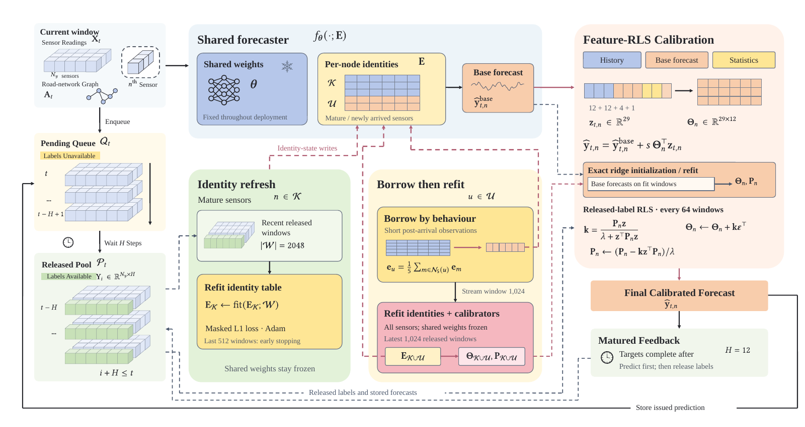

# EvoST: Adapting Traffic Forecasters to Evolving Sensor Graphs

EvoST maintains a deployed spatio-temporal forecaster while its sensor network evolves. It keeps the shared spatio-temporal weights of a checkpoint fixed and refreshes the node identities from released labels. New sensors borrow identities from behaviorally similar established sensors until a joint refit, and a per-sensor recursive least-squares (RLS) calibrator corrects forecasts as delayed feedback arrives.



**[Extended version of the paper (PDF)](paper/EvoST_extended.pdf)** · [Protocol](docs/evost_protocol.md) · [Maintenance results](docs/evost_results.md) · [Annual benchmark](docs/evost_annual.md) · [Baselines](docs/baselines.md) · [Data](data/README.md)

## Main results

Numbers as reported in the paper; every one can be traced to the saved results in this repository.

- **Which parameters need maintenance.** Twelve PeMS region-year settings are evaluated with test MAE over the one-hour horizon, all compared forecasters calibrated. Here five-year-old STAEFormer checkpoints are 17.7% worse than the target-year checkpoint.
  - Refreshing only the node identities lowers the gap to 2.5%, recovering 86% of it. Its MAE is 0.7% above that of full fine-tuning on the same recent data.
  - Tuning only the shared weights, the output head or an EAC-style input prompt, or training a model from scratch on the same windows, recovers much less.
- **Older checkpoints and other backbones.** Similar recovery holds for STAEFormer checkpoints up to fifteen years old. On sixteen settings, refreshing STID and Graph WaveNet recovers 67% and 88% of their five-year gaps.
- **Newly added sensors.** Borrowing identities at arrival and refitting all identities at stream window 1,024 leaves new sensors 3.6% and established sensors 0.3% above their references.
- **Annual benchmark** (nine EvoXXLTraffic districts and TFNSW, a separate checkpoint for each year). EvoST has the lowest Avg MAE, RMSE and MAPE among the reported non-foundation methods on all ten networks.
  - Relative to the same frozen checkpoints, it lowers Avg-MAE by 9.4% on average, of which the calibrator alone gives 8.7%.
  - Identity refresh lowers Avg-MAE below that of the calibrator alone on every network, by 0.8% on average.
  - Per step, EvoST is below the frozen checkpoints in 360 of 360 network-metric-step combinations and below the calibrated ones in 343.

## Repository map

| Path | Content | Paper |
|---|---|---|
| [experiments/evost/](experiments/evost/README.md) `g33`–`g42` | Identity maintenance, parameter-group controls, prompt and scratch controls, checkpoint ages, STID and Graph WaveNet, history budgets, sensor arrival and joint refitting | Sections 6.4–6.9, appendix |
| [experiments/evost/annual/](experiments/evost/annual/README.md) | Annual-benchmark runner (EvoST and matched controls) with the 1,165 run definitions | Section 6.3, Table 1 and Figure 6 (Tables 1 and 9 in the extended version) |
| [results/evost/](results/evost) | Per-run records and summaries of the maintenance experiments | |
| [results/evost/annual/](results/evost/annual/README.md) | Per-run, per-step and summary results of the annual benchmark | |
| [scripts/render_evost_results.py](scripts/render_evost_results.py), [scripts/render_annual_results.py](scripts/render_annual_results.py) | Rebuild or check the reported numbers from the saved results; no model execution | |
| [tables/](tables/README.md) | LaTeX sources of the paper's tables | |
| [figures/](figures/evost/README.md), [docs/assets/](docs/assets) | Plot scripts and rendered figures | |
| `main.py`, `src/`, `conf/`, `*_main.py`, `scripts/*_run.sh` | Annual-benchmark baselines ([guide](docs/baselines.md)) | Table 1 |
| [data/](data/README.md) | EvoXXLTraffic download, layout and processing | Section 3 |
| [utils/window_stats.py](utils/window_stats.py) | Training-input statistics used to standardize EvoST inputs | |

## Quick checks (CPU, no data needed)

```bash
# RLS against batch ridge regression; future labels cannot change past forecasts
python experiments/evost/selfcheck.py

# Maintenance results: verify the saved measurements and the results page
python scripts/render_evost_results.py --check

# Annual benchmark: recompute the ten-network tables and per-step counts from the per-run rows
python scripts/render_annual_results.py --check
```

The experiment modules need Python, NumPy and PyTorch; the annual check needs only the Python standard library. Full runs need the exported checkpoint bundles ([bundle format](docs/evost_bundle_format.md)); large bundles and checkpoints are not part of this repository. Run commands are in the [experiment guide](experiments/evost/README.md) and the [annual-benchmark guide](docs/evost_annual.md#run-a-network-year).

## License

[Apache-2.0](LICENSE).
