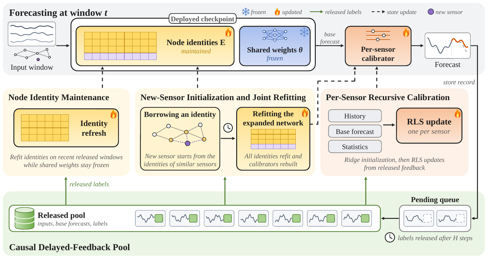

# EvoST: Adapting Traffic Forecasters to Evolving Sensor Graphs

EvoST maintains a deployed spatio-temporal forecaster while its sensor network evolves. It keeps the shared spatio-temporal weights of a checkpoint fixed and refreshes the node identities from released labels. New sensors borrow identities from behaviorally similar established sensors until a joint refit, and a per-sensor recursive least-squares (RLS) calibrator corrects forecasts as delayed feedback arrives.



**[Extended version of the paper (PDF)](paper/EvoST_extended.pdf)**

## What this repository contains

- **EvoST.** Identity refresh, new-sensor initialization with joint refitting and the per-sensor RLS calibrator: the source of the maintenance studies and of the annual runner, a bundle exporter, and the exported values of the case study.
- **The annual benchmark.** Baseline implementations and the PeMS configurations, from static forecasters to time-series foundation models. For TFNSW, the repository includes the STAEFormer configuration.
- **Saved results.** Per-run EvoST metrics and selected figure data, with CPU scripts that check the comparisons listed below.

## Getting started

### Check the reported numbers (CPU, no data)

```bash
python experiments/evost/selfcheck.py            # RLS matches batch ridge, and future labels never change past forecasts
python scripts/render_evost_results.py --check   # maintenance experiments: ratios and intervals from the saved runs
python scripts/render_annual_results.py --check  # annual benchmark: ten-network tables and per-step counts
python scripts/check_paper_numbers.py            # further figures and tables listed below
```

The first two commands need NumPy and PyTorch, the third only the Python standard library, and the last NumPy. These checks cover the comparisons listed below. They do not verify every number or reproduce every plot in the paper: the original checkpoints, the per-year baseline logs, the annual per-sensor error sums and some figure inputs are not included.

### Run EvoST

Each EvoST run reads a checkpoint bundle: the raw data splits of one network-year together with its STAEFormer checkpoints. `experiments/evost/export_bundles.py` writes the bundles from the data and per-year checkpoints. Checkpoints you train with the baseline pipeline give new runs. Reproducing the archived annual runs needs the original checkpoints, which are not included.

```bash
python experiments/evost/export_bundles.py stae --dataset PEMS03 --out bundles/stae
python experiments/evost/run.py maintenance --bundle bundles/stae/PEMS03_2020.npz \
  --seed 51 --out outputs/maintenance/PEMS03_2020/seed51 --device cuda:0
```

[Running EvoST](docs/run_evost.md) describes the available entry points, their inputs and the additional artifacts needed for each study.

### Run the baselines

```bash
conda env create -f environment.yaml && conda activate stg
GPU=0 bash scripts/pems05_run.sh   # Retrain, Pretrain, Online-NN, Online-AN, TrafficStream, STKEC and EAC on PEMS05
```

[Running the baselines](docs/baselines.md) covers every method of the benchmark tables. The time-series foundation models need their own environments ([foundation models](docs/foundation_models.md)). The data download and layout are described in [data/README.md](data/README.md).

## Where each result comes from

Main-section numbers are the same in the submitted and the extended paper. Appendix, figure and table numbers are those of the submission, with the extended version's in brackets where they differ.

| Paper | Experiment | Command | Saved results |
|---|---|---|---|
| Section 6.3, Figure 3 | Which parameters need maintenance | `run.py maintenance`, `run.py prompt` | [g37](results/evost/g37), [g42](results/evost/g42) |
| Section 6.3 [and Table 10] | Sensors the old checkpoint knows and unseen ones | `run.py maintenance` | [g37](results/evost/g37) |
| Section 6.4, Table 2 | Other backbones | `run.py stid`, `run.py gwn` | [g35](results/evost/g35), [g36](results/evost/g36), STAEFormer row in [g34](results/evost/g34) |
| Section 6.4, Figure 6(d) | Checkpoint ages | `run.py age` | [g34](results/evost/g34) |
| Section 6.4, Appendix A.3 [A.5] | STAEFormer with time inputs | `g39/e19_timeinput.py` | [g39](results/evost/g39) |
| Section 6.5, Figure 13 [Figure 4] | Sensor arrival, joint refitting and the recalibration control | `run.py arrival`, `g41/e23_recalall.py` | [g40](results/evost/g40), [g41](results/evost/g41) |
| Section 6.6, Table 1, Figures 4, 10 and 11 [Tables 1, 5–9, Figures 5, 7, 12 and 13] | Annual benchmark, including newly added sensors | `annual/e24_annual.py` and the [baselines](docs/baselines.md) | [annual](results/evost/annual/README.md) |
| Section 6.7, Figure 5 [Figure 8] | Ablation: (a) annual benchmark, (b) parameter study, (c) sensor arrival | as above | as above, and [g38](results/evost/g38) |
| Section 6.8, Figure 6(a, b) | Calibrator settings and identity learning rates of the annual runs | `annual/e24_annual.py` | [annual](results/evost/annual/README.md) |
| Section 6.8, Figure 6(c) [and Table 3] | History budget | `run.py budget` | [g38](results/evost/g38) |
| Section 6.9, Figure 7 [Figure 9] | Case study | `run.py maintenance` for panel (a); saved forecast traces for panel (b) | [case_study](results/evost/case_study/README.md) |
| Figure 12 [Figure 14] | Fitting cost | `run.py maintenance` | [g37](results/evost/g37) |
| Appendix A.3 [A.5] | Calibrator scale in the arrival runs | `g41/e25_scale.py`, `g41/scale_check.py` | [g41](results/evost/g41) |

Commands are relative to `experiments/evost/`. The folder names `g33`–`g42` are the identifiers under which the runs were made. They are kept so that the recorded file hashes still match ([details](experiments/evost/README.md)). [docs/evost_results.md](docs/evost_results.md) and [docs/evost_annual.md](docs/evost_annual.md) report the main comparisons, and `scripts/check_paper_numbers.py` checks the numbers the paper quotes from the other results in this table.

## Main results

- **Which parameters need maintenance.** Twelve PeMS region-year settings are evaluated with test MAE over the one-hour horizon, all compared forecasters calibrated. Here five-year-old STAEFormer checkpoints are 17.7% worse than the target-year checkpoint.
  - Refreshing only the node identities lowers the gap to 2.5%, recovering 86% of it. The refreshed model's MAE is 0.7% above that of full fine-tuning on the same recent data.
  - Tuning only the shared weights, the output head or an EAC-style input prompt, or training a model from scratch on the same windows, recovers much less.
- **Older checkpoints and other backbones.** Similar recovery holds for STAEFormer checkpoints up to fifteen years old. On sixteen settings, refreshing STID and Graph WaveNet recovers 67% and 88% of their five-year gaps.
- **Newly added sensors.** Borrowing identities at arrival and refitting all identities at stream window 1,024 leaves new sensors 3.6% and established sensors 0.3% above their references.
- **Annual benchmark** (nine EvoXXLTraffic districts and TFNSW, a separate checkpoint for each year). EvoST has the lowest Avg MAE, RMSE and MAPE among the reported non-foundation methods on all ten networks.
  - Relative to the same frozen checkpoints, it lowers Avg-MAE by 9.4% on average, of which the calibrator alone gives 8.7%.
  - Identity refresh lowers Avg-MAE below that of the calibrator alone on every network, by 0.8% on average.
  - Per step, EvoST is below the frozen checkpoints in 360 of 360 network-metric-step combinations and below the calibrated ones in 343.

## Repository layout

| Path | Content |
|---|---|
| [experiments/evost/](experiments/evost/README.md) | EvoST source: the maintenance experiments (`run.py`) and the annual-benchmark runner (`annual/`) |
| [results/evost/](results/evost) | Saved per-run records and summaries ([annual benchmark](results/evost/annual/README.md)) |
| [scripts/](scripts) | Baseline runners, environment setup, and the scripts that recompute the reported numbers |
| `main.py`, `stkec_main.py`, `src/`, `conf/` | Baselines of the annual benchmark and their configurations |
| `timesfm_*.py`, `chronos_*.py`, `moirai_*.py` | Time-series foundation-model baselines |
| [data/](data/README.md) | EvoXXLTraffic download, layout and processing notebooks |
| [tables/](tables/README.md), [figures/](figures/evost/README.md), [docs/assets/](docs/assets) | LaTeX sources of the paper's tables, plot scripts and rendered figures |
| [docs/](docs) | Guides: [running EvoST](docs/run_evost.md), [running the baselines](docs/baselines.md), [foundation models](docs/foundation_models.md), [protocol](docs/evost_protocol.md), [maintenance results](docs/evost_results.md), [annual benchmark](docs/evost_annual.md), [bundle format](docs/evost_bundle_format.md) |
| [utils/](utils) | Shared helpers, including the training-input statistics used to standardize EvoST inputs |

## License

[Apache-2.0](LICENSE).
