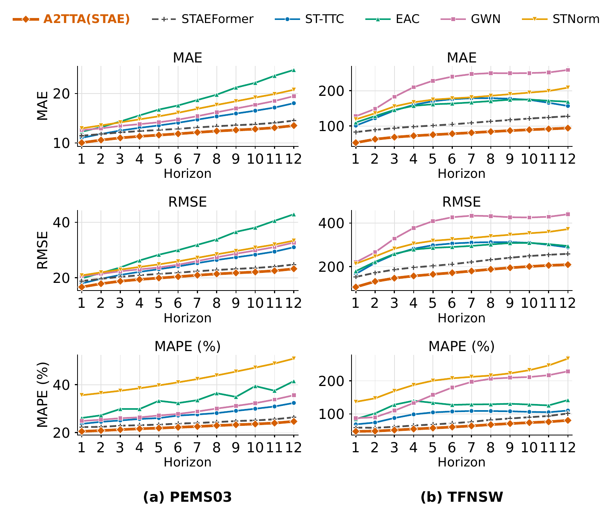
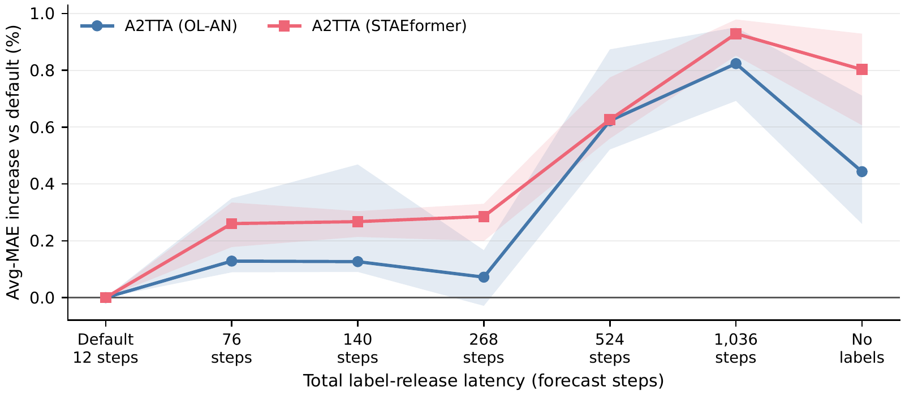
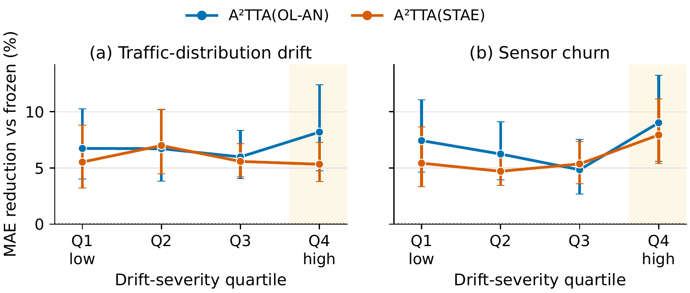
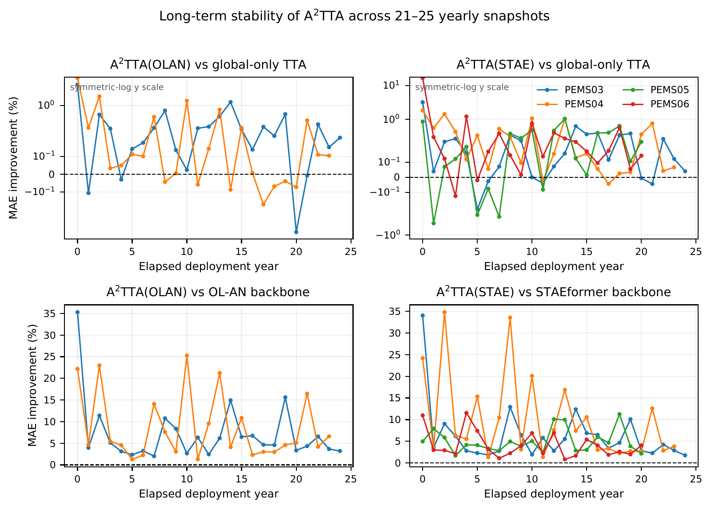

# Annual benchmark: results and diagnostics

This archive preserves the original A²TTA experiment section, including all numerical claims and its evaluation distinctions. A²TTA freezes the forecasting backbone and uses FiLM calibration with a temporary local clone. [EvoST's identity-maintenance results](evost_results.md) use a separate protocol and are reported independently.

[Complete baseline table](../tables/main_table.md) · [extended appendix](extended_experiments.md) · [original experiment TeX](paper_sources/annual_experiments_original.tex).

[Complete annual benchmark table](../tables/main_table.md) · [original table source](paper_sources/table/main01.tex)

## Experimental Settings

PeMS experiments use the first 31 days of each selected year;
Table [tab:evo_scale](../data/README.md) summarizes the full data archive.
Each year uses a chronological 60%/20%/20% train/validation/test split.
PEMS windows contain 12 five-minute steps and TFNSW windows contain 12 hourly
steps. All methods share the graph snapshots, splits, test windows, and metric
code. Normalization uses training statistics only; residual non-finite inputs
are set to zero after normalization, and invalid targets are masked.

Online methods process one chronological window at a time, match nodes by
metadata sensor IDs, and release each target after 12 steps. A²TTA keeps
512 released windows and updates its global state every 64 windows. Static
methods receive the same windows without test labels. We report cumulative
mean absolute error (MAE), root mean square error (RMSE), and mean absolute
percentage error (MAPE) at horizons 3, 6, and 12. Avg averages the cumulative
scores from horizons 1 to 12, with Avg-MAE as the primary metric. Results use
five paired seeds unless noted otherwise.

A²TTA(OLAN) and A²TTA(STAE) load and freeze the exact per-year
Online-AN and STAEFormer checkpoints, respectively. Other than learning rate,
their adaptation settings are shared. Appendix [app:hyper_details](extended_experiments.md#app-hyper-details) lists
the learning rates and sensitivity results.

## Baselines

We compare nine static forecasters (DCRNN, ASTGNN, TGCN, GWN, STID, STNorm,
iTrans, DLinear, and STAEFormer); Pretrain, Retrain, Online-NN, and Online-AN;
four evolving-graph methods (TrafficStream, PECPM, STKEC, and EAC); STRAP and
ST-TTC; and zero-shot (ZS) or yearly fine-tuned (FT) versions of Chronos-2,
TimesFM 2.5, and Moirai-2.0.

Each matched A²TTA/backbone pair shares checkpoint seeds, yearly cohorts,
and preprocessing. New-sensor results use the metadata set difference
$\mathcal V_y\setminus\mathcal V_{y-1}$ at every graph-growing transition
with the same five paired seeds. This isolates calibration from checkpoint,
cohort, and node-order differences.

## Main Results

### Overall performance

Results for three representative networks appear in
[tab:main_by_method_part1](../tables/main_table.md).
A²TTA(STAE) has the lowest MAE, RMSE, and MAPE on all three, reducing
Avg-MAE over frozen STAEFormer by 9.4%, 13.8%, and 29.4%. On TFNSW,
A²TTA(OLAN) reduces MAE from 130.61 to 86.78 (33.6%) and RMSE from
235.35 to 176.97 (24.8%).

### Comparison with time-series foundation models

TSFMs are reference rows and are not included in the non-foundation ranking.
A²TTA(STAE) outperforms every zero-shot and fine-tuned TSFM cell in
[tab:main_by_method_part1](../tables/main_table.md), while updating only its calibrator after
label release. Appendix [appendix](extended_experiments.md#appendix) reports the other seven PEMS districts
and horizons 3, 6, and 12 for all ten networks
([tab:main_by_method_part2](../tables/main_table.md), [tab:main_by_method_part3](../tables/main_table.md), [tab:main_part1](../tables/main_table.md), [tab:main_part2](../tables/main_table.md)).

### Forecast horizons

Across all 12 steps in [per_horizon](#per-horizon), A²TTA(STAE) has the lowest error
on PEMS03 and TFNSW. Its mean per-step MAE reductions over frozen STAEFormer
are 8.2% and 27.3%. Appendix [appendix](extended_experiments.md#appendix) gives results for all sensors and
the newly added subset on all ten datasets
([per_horizon_all_app](extended_experiments.md#per-horizon-all-app), [per_horizon_new_app](extended_experiments.md#per-horizon-new-app)).

[Vector PDF](assets/per_horizon_all_pems03_tfnsw_3x2.pdf). All-sensor per-step errors on PEMS03 and TFNSW. Lower is better.

## Delayed-Label Sensitivity

[fig:delay_sensitivity](#fig-delay-sensitivity) uses all ten networks. For PEMS12, Avg-MAE rises by 0.68% at 524 steps, 0.95% at 1,036 steps, and 0.65% without online labels. Across ten networks, the median increases at 524 steps are 0.62% for A²TTA(OLAN) and 0.63% for A²TTA(STAE); without online labels, they are 0.44% and 0.80%. The sweep changes only the release delay under the one-window protocol.

[Vector PDF](assets/delayed_label_common_median_iqr.pdf). Delayed-label sensitivity; bands show the interquartile range.

## Ablation Study

Full A²TTA has the lowest Avg-MAE in seven of eight settings in
[fig:ablation](#fig-ablation). On Online-AN and STAEFormer, respectively, reverting to
the frozen backbone raises error by 6.5% and 6.7%, replacing FiLM with a
static affine transform by 3.7% and 4.7%, and removing the local clone by
1.2% and 1.6%. Freezing FiLM after warm-up is worse in seven settings but
better on STAEFormer with PEMS06. Appendix [app:ablation_details](extended_experiments.md#app-ablation-details) defines
the variants and gives the full results.

[Vector PDF](assets/ablation_d_absolute_avg_mae_high_contrast.pdf). Component knockouts on four PEMS datasets and two frozen backbones.

## Newly Added Sensors / High-Drift Periods

[Vector PDF](assets/new_sensor_baselines3.pdf). New-sensor performance.

For the metadata-defined new-sensor cohort, A²TTA(STAE) is best in five of
six panels in [new](#new): all metrics on PEMS07 and MAE and MAPE on TFNSW.
A²TTA(OLAN) has lower TFNSW RMSE (177.20 versus 178.38).
A²TTA(STAE) reduces MAE over frozen STAEFormer by 8.8% on PEMS07 and
33.7% on TFNSW. Appendix [app:new_sensors](extended_experiments.md#app-new-sensors) gives all ten datasets.

### High-drift periods

[Vector PDF](assets/drift_gain_main.pdf). Performance across drift-severity quartiles.

[fig:drift_gain](#fig-drift-gain) groups paired dataset-year results by drift severity.
A²TTA improves both backbones in every quartile, with all 95% bootstrap
intervals above zero. Gains peak in the highest sensor-churn quartile at 9.0%
over Online-AN and 7.9% over STAEFormer. This legacy-batched diagnostic shows
an association, not a causal effect; Appendix [app:drift_details](extended_experiments.md#app-drift-details) gives
the other metrics and aggregation.

[Vector PDF](assets/case_a2_c_horizontal_PEMS06_2015.pdf). Two-seed case study on PEMS06-2015.

## Case Study

[fig:case](#fig-case) examines a high-variance PEMS06-2015 new sensor selected
without using either method's errors. Over seeds 51 and 52, A²TTA tracks
the morning rise more closely, especially at 60 minutes. Across 366 sensors,
it beats Online-AN on 99.7% and STAEFormer on 98.6%, reducing mean
per-sensor MAE by 7.29% and 2.62%. Appendix [app:case_details](extended_experiments.md#app-case-details) gives
selection and cohort details.

[Vector PDF](assets/long_term_stability.pdf). Long-term five-seed stability.

## Long-Term Adaptation

The legacy-batched five-seed analysis in [fig:long_term_stability](#fig-long-term-stability) covers
six streams over 21 to 25 years. Gains over the frozen backbone are positive
every year; gains over global-only TTA are smaller and less uniform.
Appendix [app:long_term_details](extended_experiments.md#app-long-term-details) gives a pre-specified single-seed check
on all ten datasets.

### Deployment cost

We profile 233 yearly snapshots on an H200. A²TTA(STAE) takes 11.60 ms
per window versus 10.48 ms for frozen STAEFormer and raises peak allocated
memory from 10,021 to 10,552 MiB. It updates 33.2K calibrator parameters on
average versus 2.06M backbone parameters. A²TTA(OLAN) takes 5.35 ms
versus 4.30 ms. Appendix [app:protocol_cost](extended_experiments.md#app-protocol-cost) gives the three-repeat
protocol and additional measurements.
