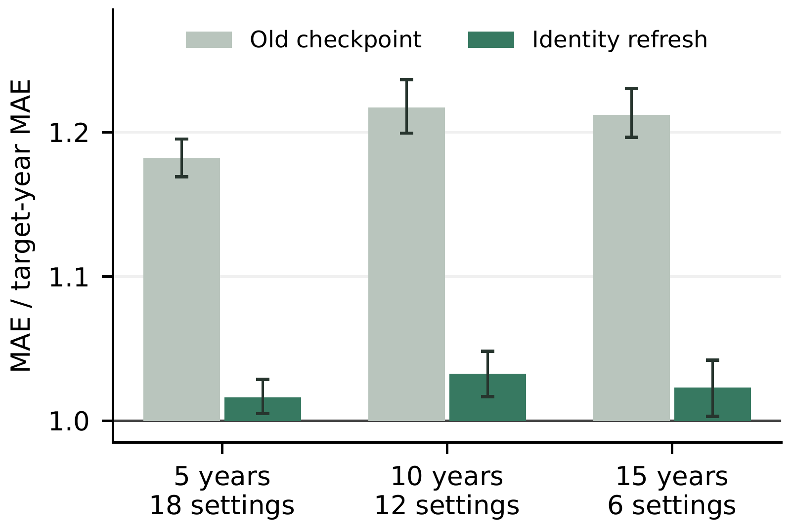

# EvoST results

The primary experiment uses five-year-old STAEFormer checkpoints on twelve PeMS region-year settings. All maintenance arms and the target-year reference use delayed-feedback RLS calibration. Ratios below one favor the maintained model. [Protocol](evost_protocol.md) · [source and run commands](../experiments/evost/README.md) · [measurement records](../results/evost).

## Which parameters require maintenance?

The intervals use 10,000 district bootstrap draws after averaging three seeds within each setting. The prompt and scratch controls use the same recent observations and target-year reference as the parameter-update comparison.

| Updated parameters / control | Relative H12 MAE | 95% interval |
|---|---:|---:|
| Old checkpoint | 1.177 | [1.166, 1.187] |
| Output head | 1.148 | [1.138, 1.158] |
| Shared weights | 1.078 | [1.068, 1.089] |
| Added node prompt | 1.130 | [1.122, 1.140] |
| Recent-data scratch | 1.123 | [1.098, 1.141] |
| Identity refresh (EvoST) | 1.025 | [1.015, 1.037] |
| Identities + prompt | 1.023 | [1.014, 1.033] |
| All parameters | 1.018 | [1.010, 1.027] |

Identity refresh reduces the gap to the calibrated target-year model from 17.7% to 2.5%. It captures 95% of the improvement from full-parameter fine-tuning on the same recent data.

## Absolute MAE over the one-hour forecast horizon

Cumulative MAE across steps 1–12, averaged over seeds 51, 52, and 53. The target-year model is trained separately; recent-data scratch uses only the maintenance history.

| Region/year | Target-year | Old | Shared | Prompt | Scratch | EvoST | Full FT |
|---|---:|---:|---:|---:|---:|---:|---:|
| PEMS03/2020 | 11.03 | 12.84 | 11.72 | 11.97 | 12.17 | 11.17 | 10.94 |
| PEMS03/2025 | 9.37 | 11.36 | 10.70 | 11.11 | 10.86 | 10.12 | 9.95 |
| PEMS06/2020 | 10.20 | 13.03 | 11.20 | 12.01 | 11.54 | 10.60 | 10.51 |
| PEMS06/2025 | 10.65 | 11.71 | 10.96 | 11.60 | 11.76 | 10.57 | 10.54 |
| PEMS08/2020 | 10.77 | 13.49 | 12.10 | 13.02 | 12.61 | 11.22 | 11.25 |
| PEMS08/2025 | 12.24 | 13.60 | 12.80 | 13.45 | 13.51 | 12.13 | 12.09 |
| PEMS10/2020 | 9.95 | 12.10 | 11.06 | 11.48 | 10.55 | 10.63 | 10.61 |
| PEMS10/2025 | 9.11 | 10.63 | 9.63 | 10.04 | 9.77 | 9.27 | 9.20 |
| PEMS11/2020 | 12.76 | 15.05 | 13.93 | 14.55 | 14.65 | 13.54 | 13.47 |
| PEMS11/2025 | 14.19 | 16.07 | 14.72 | 15.64 | 15.94 | 14.04 | 13.83 |
| PEMS12/2020 | 12.42 | 14.38 | 13.46 | 13.88 | 14.71 | 12.73 | 12.69 |
| PEMS12/2025 | 12.15 | 14.22 | 12.83 | 13.53 | 13.62 | 12.06 | 12.02 |

## Other horizons and metrics

Ratios use the matching metric of the calibrated target-year reference. H3, H6, and H12 aggregate steps 1–3, 1–6, and 1–12; Avg averages the twelve cumulative-horizon MAEs. The committed horizon sums independently verify this convention.

| Control | H3 MAE | H6 MAE | H12 MAE | H12 RMSE | Avg MAE |
|---|---:|---:|---:|---:|---:|
| Old checkpoint | 1.075 | 1.111 | 1.177 | 1.154 | 1.117 |
| Output head | 1.064 | 1.093 | 1.148 | 1.129 | 1.098 |
| Shared weights | 1.033 | 1.049 | 1.078 | 1.069 | 1.051 |
| Added node prompt | 1.062 | 1.087 | 1.130 | 1.114 | 1.090 |
| Recent-data scratch | 1.061 | 1.084 | 1.123 | 1.117 | 1.086 |
| Identity refresh (EvoST) | 1.013 | 1.017 | 1.025 | 1.026 | 1.018 |
| Identities + prompt | 1.011 | 1.016 | 1.023 | 1.024 | 1.016 |
| All parameters | 1.007 | 1.011 | 1.018 | 1.021 | 1.012 |

## Additional architectures

Sixteen region-year settings per architecture. STAEFormer uses fixed-rate refresh in this extension. Each ratio uses that architecture's calibrated target-year model. Recovery is the fraction of its old-to-reference error gap closed.

| Backbone | Settings | Old | Identity refresh | Gap recovered |
|---|---:|---:|---:|---:|
| STAEFormer | 16 | 1.180 | 1.033 | 82% |
| STID | 16 | 1.045 | 1.015 | 67% |
| Graph WaveNet | 16 | 1.091 | 1.011 | 88% |

## Checkpoint age

[Vector figure](assets/evost_checkpoint_age.pdf) · [editable data and plot code](../figures/evost). The age groups contain different sets of region-year settings.

## Recent-history budget

Fit windows include the identity holdout. Selection uses an additional validation prefix for calibration. The identity learning rate is fixed in this study. Ratios use the calibrated target-year reference at the same budget.

| Fit windows | Selection windows | Old | Identity refresh |
|---|---:|---:|---:|
| 64 | 32 | 1.208 | 1.214 |
| 256 | 128 | 1.153 | 1.198 |
| 1024 | 512 | 1.175 | 1.046 |
| 2048 | 1024 | 1.177 | 1.026 |

## Sensor arrival and joint refitting

These results use the test portion after the scheduled event. New and all-sensor errors are divided by the calibrated target-year reference. Established-sensor errors are divided by the mature model without arrivals. Arrival history and the shared-scale convention are specified in the [protocol](evost_protocol.md#arrival-and-joint-refitting).

| Strategy | New | All | Established |
|---|---:|---:|---:|
| Borrow and keep | 1.115 | 1.052 | 1.008 |
| Refit new identities | 1.038 | 1.035 | 1.008 |
| Refit all (EvoST) | 1.036 | 1.032 | 1.003 |

## Fitting cost

Median costs from the primary STAEFormer maintenance study on H100 runs. Search time includes three candidate learning rates. These measurements cover fitting, excluding RLS calibration.

| Updated group | Trainable values | Seconds/epoch | Search seconds | Peak GiB |
|---|---:|---:|---:|---:|
| Identity refresh | 1.41M | 11.5 | 259 | 10.4 |
| Full fine-tuning | 2.01M | 14.0 | 327 | 11.4 |
| Shared weights | 0.60M | 13.7 | 334 | 11.6 |
| Output head | 0.02M | 4.8 | 180 | 4.5 |

## Complete study records

The saved summaries include calibrated and uncalibrated comparisons, established/new-sensor cohorts, and the additional diagnostic branches. Primary, secondary, and development settings keep their original labels.

- [Fixed-rate refresh and donors: summary](../results/evost/refresh_and_donors/summary.json) · [per-run records](../results/evost/refresh_and_donors/runs)
- [Districts and checkpoint ages: summary](../results/evost/checkpoint_ages/summary.json) · [per-run records](../results/evost/checkpoint_ages/runs)
- [STID: summary](../results/evost/stid/summary.json) · [per-run records](../results/evost/stid/runs)
- [Graph WaveNet: summary](../results/evost/graph_wavenet/summary.json) · [per-run records](../results/evost/graph_wavenet/runs)
- [Parameter groups: summary](../results/evost/parameter_groups/summary.json) · [per-run records](../results/evost/parameter_groups/runs)
- [History budgets and initialization: summary](../results/evost/history_budget/summary.json) · [per-run records](../results/evost/history_budget/runs)
- [Time-input sensitivity: summary](../results/evost/time_inputs/summary.json) · [per-run records](../results/evost/time_inputs/runs)
- [New-identity refitting: summary](../results/evost/new_sensor_refit/summary.json) · [per-run records](../results/evost/new_sensor_refit/runs)
- [Joint refitting: summary](../results/evost/sensor_arrival/summary.json) · [per-run records](../results/evost/sensor_arrival/runs)
- [Prompt and scratch controls: summary](../results/evost/prompt_and_scratch/summary.json) · [per-run records](../results/evost/prompt_and_scratch/runs)

The [annual benchmark](evost_annual.md) reports EvoST and its matched controls on the same-year checkpoints of ten networks.
