# Extended experiments and appendix

The A²TTA results retain their original method names, metrics, and evaluation protocols. The [annual experiment section](annual_benchmark_analysis.md) supplies the original main results, delayed-label sweep, ablations, and case studies. EvoST maintenance results are in the [EvoST results](evost_results.md). [Rendered appendix PDF](assets/extended_appendix.pdf) · [full LaTeX appendix](paper_sources/appendix.tex) · [bibliography](paper_sources/references.bib).

## Structural Evolution Details

Figure [fig:graph_evo](#fig-graph-evo) tracks average node degree and graph density
for the yearly proximity graphs. With $N$ nodes and $E$ undirected edges
counted once, these quantities are $2E/N$ and $2E/[N(N-1)]$, respectively.
Both change non-monotonically as sensor additions and removals alter local
neighborhoods and spatial connections. Successive snapshots therefore
differ in both dimension and connectivity.

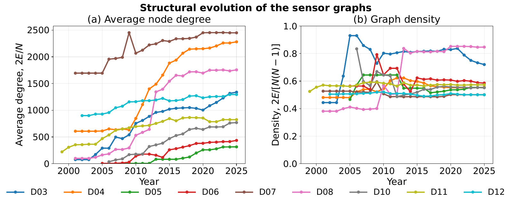

[Vector PDF](assets/fig_graph_evo.pdf). Yearly evolution of the sensor proximity graphs. Average node
degree and graph density both vary non-monotonically.

## Extended Related Work

### Spatio-Temporal Traffic Forecasting

Traffic forecasting, including traffic flow, speed, and congestion status, has always been one of the most important issues in computational urban and intelligent transportation systems. Early traffic forecasting methods primarily relied on statistical modeling and traditional machine learning methods, such as Historical Average (HA), Autoregressive Integrated Moving Average (ARIMA) [[box2015time](paper_sources/references.bib)], Seasonal ARIMA [[williams2003modeling](paper_sources/references.bib)], Kalman filtering [[kumar2017traffic](paper_sources/references.bib)], Vector Autoregression (VAR) [[schimbinschi2017topology](paper_sources/references.bib)], Support Vector Regression (SVR) [[wu2004travel](paper_sources/references.bib)], and $k$-Nearest Neighbors (kNN) [[cai2016spatiotemporal](paper_sources/references.bib)]. These methods typically treat traffic sequences as one-dimensional or low-dimensional time series and make predictions by modeling trends, periodicity, and short-term autocorrelation in historical observations. Among them, HA uses historical averages over the same period as predictions, making it simple and efficient but difficult to adapt to sudden changes. ARIMA and its variants can characterize linear temporal dependence and periodic patterns but usually rely on stationarity assumptions. Kalman filtering is suitable for online state estimation and short-term forecasting, while SVR and kNN improve predictive capability through nonlinear mapping or similar-pattern matching. Nevertheless, these methods mostly rely on manual feature design and struggle to characterize complex nonlinear temporal variations and spatial dependencies within road networks simultaneously.

Deep traffic forecasting has used convolutional neural networks (CNNs), recurrent neural networks (RNNs), graph neural networks (GNNs), Transformers, and, more recently, state-space models. Early temporal models used long short-term memory (LSTM) or gated recurrent unit (GRU) networks to capture long-range dependencies. CNNs [[shih2019temporal](paper_sources/references.bib)] and temporal convolutional networks (TCNs) [[van2016wavenet](paper_sources/references.bib)] later improved parallelism while retaining local temporal structure. Graph models then made road-network dependencies explicit. Representative methods include T-GCN [[zhao2019t](paper_sources/references.bib)], STGCN [[yu2018spatio](paper_sources/references.bib)], and DCRNN [[li2018diffusion](paper_sources/references.bib)]. T-GCN places graph convolution inside GRU units, STGCN combines graph and temporal convolutions, and DCRNN models directed propagation with diffusion convolution and an encoder-decoder architecture. GNNs have also been applied to regional multimodal demand forecasting: Ma et al. [[ma2022forecasting](paper_sources/references.bib)] release an NYC taxi-bike dataset and study multi-source, multi-graph, and meta-information-enhanced STGNNs. Our setting instead concerns sensor graphs whose nodes and connectivity change over time.

Traffic forecasting models have since developed toward adaptive graph learning, attention mechanisms, and large-scale sequence modeling. Graph WaveNet [[wu2019graph](paper_sources/references.bib)], for example, reduces reliance on predefined adjacency matrices by learning adaptive spatial dependencies. ASTGCN [[guo2019attention](paper_sources/references.bib)], GMAN [[zheng2020gman](paper_sources/references.bib)], and STTN [[xu2020spatial](paper_sources/references.bib)] introduce spatio-temporal attention to dynamically model relationships among sensors and time steps. Transformer-based models are now widely used because of their long-sequence modeling capability, while state-space models offer linear-complexity alternatives for large-scale forecasting. This development has produced many strong models, including MTMGNN [[yin2023mtmgnn](paper_sources/references.bib)], STQCL [[yin2024enhancing](paper_sources/references.bib)], STAEFormer [[liu2023spatio](paper_sources/references.bib)], STID [[shao2022spatial](paper_sources/references.bib)], HIMNet [[dong2024heterogeneity](paper_sources/references.bib)], PDFormer [[jiang2023pdformer](paper_sources/references.bib)], and AutoSTF [[lyu2025autostf](paper_sources/references.bib)].

Despite their progress on static benchmarks, most existing methods assume that the sensor set and road-network topology remain unchanged between training and testing. In real deployments, however, sensor networks expand over time, new sensors are commissioned, and connectivity and traffic patterns drift. A deployed forecaster therefore faces not merely a longer time series but a continuously evolving traffic graph. The resulting node growth, topology change, and temporal distribution shift challenge models built under a fixed-graph assumption.

### Online and Continual Traffic Forecasting

Long-term traffic-system deployment has consequently motivated online and continual forecasting. New sensors are repeatedly added, while traffic patterns at existing nodes evolve over time. An effective model must therefore acquire new spatio-temporal patterns without catastrophically forgetting previously learned knowledge.

TrafficStream [[ijcai2021p0498](paper_sources/references.bib)] was among the first methods to formalize network expansion and pattern evolution as a streaming continual-learning problem. It uses local subgraphs to integrate neighborhood information for new sensors, Jensen–Shannon divergence to detect drift at existing nodes, and historical replay with parameter smoothing to mitigate catastrophic forgetting. Following an explicit-memory approach, PECPM [[wang2023pattern](paper_sources/references.bib)] maintains a library of representative spatio-temporal patterns and updates only new or conflicting nodes when a new graph arrives. STKEC [[wang2023knowledge](paper_sources/references.bib)] selects influential old nodes to construct local subgraphs, combines them with a memory bank for long-term periodic patterns, and preserves prior knowledge through parameter-distance regularization. To reduce update cost, EAC [[chen2025expand](paper_sources/references.bib)] uses a continual prompt pool to represent knowledge from different stages and follows an expansion–compression strategy that avoids large-scale updates of the whole model. STBP [[liugeneral](paper_sources/references.bib)] freezes a general spatio-temporal backbone and expands only a scalable contextual pattern library, balancing stability and plasticity. STEV [[ma2025beyond](paper_sources/references.bib)] treats new sensors as a variable-expansion problem and uses a flattening scheme to improve robustness to varying input scales. STRAP [[zhang2025strap](paper_sources/references.bib)] constructs an external pattern library and retrieves similar patterns as prompts at inference time. ST-TTC [[chen2025learning](paper_sources/references.bib)] performs test-time calibration with frequency-domain alignment and streaming memory queues, but primarily addresses temporal drift within a fixed node set.

Unlike methods that update substantial model components or depend on large replay memories, we adapt only a residual calibrator attached to a frozen forecaster. Records remain pending until their complete forecast horizon has elapsed. Released records update the global calibrator, and the local clone weights the retained pool by temporal phase, traffic-pattern similarity, and recency. This design handles node growth, topology change, and traffic drift without updating the deployed forecasting backbone.

## Complete Main Results

[Complete baseline table](../tables/main_table.md)

[Complete baseline table](../tables/main_table.md)

### Average performance on the remaining districts

[tab:main_by_method_part2](#tab-main-by-method-part2), [tab:main_by_method_part3](#tab-main-by-method-part3) add PEMS05 to PEMS08 and PEMS10 to PEMS12 to the representative results in [tab:main_by_method_part1](#tab-main-by-method-part1). Across all ten networks, A²TTA(STAE) is the best non-foundation method in all 30 Avg dataset-metric comparisons. Averaged equally across datasets, it reduces MAE, RMSE, and MAPE over STAEFormer by 11.0%, 8.5%, and 9.7%, respectively. A²TTA(OLAN) improves Online-AN by 12.8%, 9.7%, and 12.2% on the same metrics.

### Table conventions

In [tab:main_by_method_part2](#tab-main-by-method-part2), [tab:main_by_method_part3](#tab-main-by-method-part3), each row is one
baseline and each dataset reports MAE, RMSE, and MAPE in percent. Avg denotes
the mean of cumulative-horizon scores over prediction lengths 1–12. Entries
are mean$\pm$standard deviation (SD) where available and deterministic zero-shot references are
single-run and shown with $\pm0.00$. Chronos-2 uses multivariate graph-grouped
inference, with per-year low-rank adaptation (LoRA) for its FT variant. Bold and
underlined entries mark the best and second-best non-foundation methods,
respectively. Foundation-model rows are excluded from highlighting.

[Per-horizon table source, part 1](paper_sources/table/main3612_1.tex)

[Per-horizon table source, part 2](paper_sources/table/main3612_2.tex)

### Per-horizon performance and TSFM comparison

For compactness, the preceding tables average cumulative errors over prediction lengths 1 to 12. [tab:main_part1](#tab-main-part1), [tab:main_part2](#tab-main-part2) report horizons 3, 6, and 12, where A²TTA-S and A²TTA-O denote A²TTA(STAE) and A²TTA(OLAN), respectively. A²TTA-S is the best non-foundation method in 119 of the 120 reported cells. The exception is PEMS06 MAE at horizon 3, where A²TTA-O is lower. Its MAE reductions over STAEFormer average 12.1%, 10.8%, and 9.7% at horizons 3, 6, and 12. A²TTA-O improves Online-AN by 13.2%, 12.7%, and 12.3%.

Across the three horizons and Avg rows, A²TTA-S also outperforms the strongest TSFM reference in 113 of 120 cells, including all 30 Avg cells. Fine-tuning remains important for the foundation models: Chronos-2, TimesFM 2.5, and Moirai-2.0 improve over their zero-shot counterparts in all 30 Avg dataset-metric comparisons, with mean relative reductions of 13.5%, 10.9%, and 15.4%, respectively.

### Per-horizon table conventions

In [tab:main_part1](#tab-main-part1), [tab:main_part2](#tab-main-part2), A²TTA-S and A²TTA-O are
evaluated over five seeds, and MAPE is reported in percent. Compact headers
pair zero-shot and fine-tuned variants: Chro2-Z/F, TimesF-Z/T, Moira1-Z/T,
and Moira2-Z/T. Deterministic zero-shot references are single-run and shown
with $\pm0.00$, whereas fine-tuned references report mean$\pm$SD over three
seeds. Chronos-2 uses multivariate graph-grouped inference and per-year LoRA
fine-tuning for its FT variant. TSFM columns are excluded from best/second-best
highlighting. Pretrain fixes the first-year model, Retrain starts from scratch each year,
Online-NN updates new sensors, and Online-AN updates all active sensors.

### Complete Per-Horizon Results

The main text uses PEMS03 and TFNSW for a readable per-horizon comparison. Here, we report the complete 12-step profiles for all nine EvoXXLTraffic districts and TFNSW. The curves use per-step rather than cumulative errors. The A²TTA curves follow the one-window delayed-feedback protocol used by the main runs.

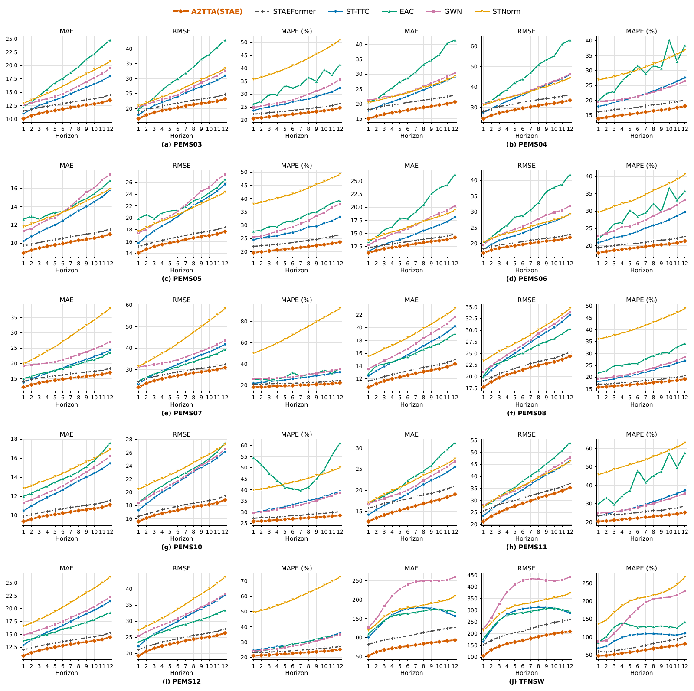

[Vector PDF](assets/per_horizon_all_10datasets_5x6.pdf). All-sensor per-step results on ten networks.

### All sensors

As shown in [per_horizon_all_app](#per-horizon-all-app), A²TTA(STAE) has the lowest error among the six plotted methods in all $10\times3\times12=360$ combinations. Averaged over dataset and horizon, it improves on frozen STAEFormer by 9.7% in MAE, 7.3% in RMSE, and 9.3% in MAPE.

### Detailed Results on Newly Added Sensors

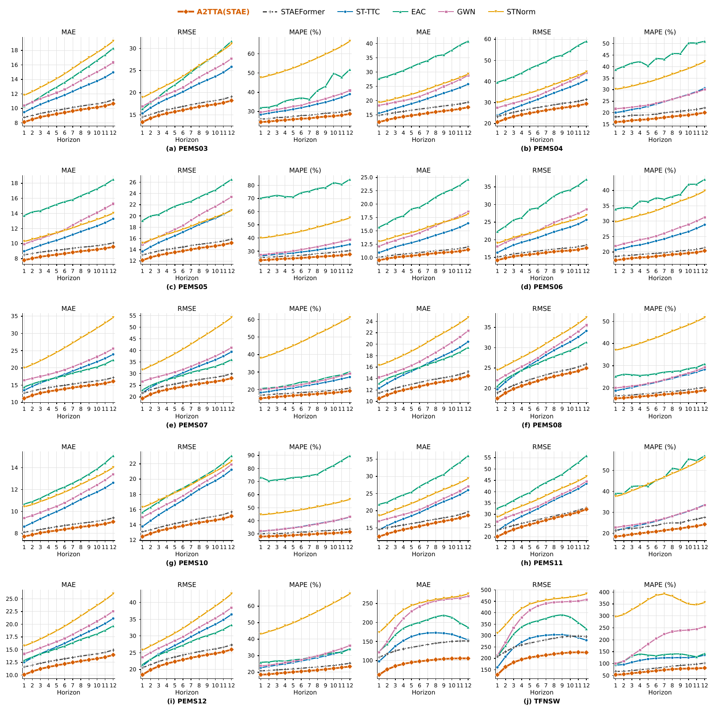

[Vector PDF](assets/per_horizon_new_10datasets_5x6.pdf). New-sensor per-step results on ten networks.

### Newly added sensors

[per_horizon_new_app](#per-horizon-new-app) isolates nodes added at graph-growing transitions. A²TTA(STAE) is best in all 360 plotted combinations and reduces MAE, RMSE, and MAPE relative to frozen STAEFormer by 9.1%, 7.4%, and 8.8% on average, respectively.

### Average-horizon baseline comparison

While the per-step plot focuses on six representative methods,
[new](#new), [new_app](#new-app) broadens the Avg comparison to the full baseline set. Together, the figures cover all nine EvoXXLTraffic districts and TFNSW. A²TTA(STAE) ranks first in 29 of the 30 comparable panels. The only exception is TFNSW RMSE, where A²TTA(OLAN) records 177.20 and A²TTA(STAE) records 178.38. Averaged equally across datasets, A²TTA(STAE) reduces MAE, RMSE, and MAPE by 10.2%, 8.3%, and 9.2% relative to frozen STAEFormer, and by 8.8%, 8.1%, and 7.0% relative to A²TTA(OLAN). Its MAE reduction over frozen STAEFormer ranges from 4.2% on PEMS10 to 33.7% on TFNSW, including 12.6% on PEMS04 and 9.9% on PEMS11. Daggered TSFM-FT bars are all-sensor references and are excluded from these new-sensor rankings.

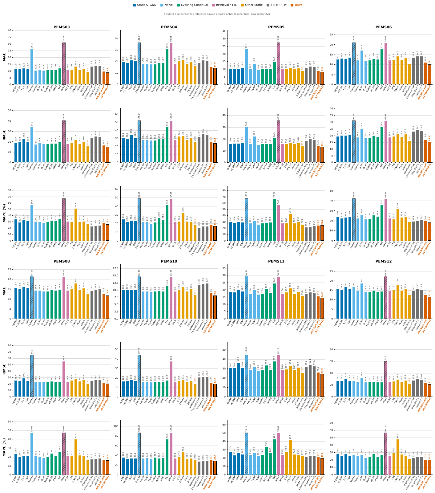

[Vector PDF](assets/new_sensor_baselines4.pdf). New-sensor Avg errors on the remaining eight datasets.

## Drift-Severity Analysis Details

### Metrics and aggregation

This auxiliary diagnostic uses legacy batched outputs. It joins drift
measurements to paired yearly errors from the five-seed analysis and to one
pre-specified seed for the all-network breadth check.
For consecutive years $y-1$ and $y$, traffic-distribution drift is the
1-Wasserstein distance between deterministic samples of the two raw traffic
arrays, normalized by their average standard deviation. Graph-density drift is
$|\log(\delta_y/\delta_{y-1})|$, where $\delta_y$ is the nonzero adjacency
density. For TFNSW, sensor churn is computed from exact yearly sensor IDs as
$(|\mathcal V_y\setminus\mathcal V_{y-1}|+ |\mathcal V_{y-1}\setminus\mathcal V_y|)/ |\mathcal V_y\cup\mathcal V_{y-1}|$. The corresponding PEMS analysis uses the conservative net-count lower bound $|N_y-N_{y-1}|/\max(N_y,N_{y-1})$, because the processed experimental arrays
used for this diagnostic do not retain the full station-ID transition record.

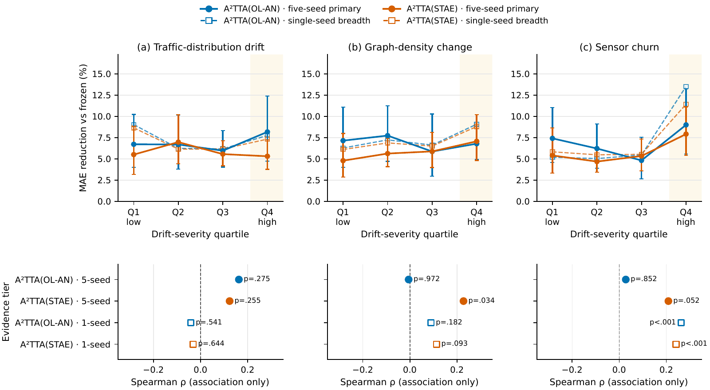

[Vector PDF](assets/drift_gain_appendix.pdf). Drift-severity diagnostics.

For a backbone $b$, the relative gain in dataset $d$ and year $y$ is
$100(\mathrm{MAE}_{b,d,y}-\mathrm{MAE}_{\mathrm{A^2TTA}(b),d,y})/ \mathrm{MAE}_{b,d,y}$. The primary layer first averages the errors within each
dataset-year over the five paired seeds and contains 47 Online-AN and 87
STAEFormer yearly cells. Quartiles are formed separately for each backbone and
drift signal. Their intervals are nonparametric 95% bootstrap intervals over
the resulting yearly cells, rather than seed-level intervals. The breadth
layer uses one pre-specified seed and covers 223 adjacent-year cells per
backbone across all ten networks. It is a breadth check rather than an
additional inference layer and therefore has no error bars.

### Detailed observations

Full A²TTA improves every yearly cell in the paired five-seed layer, so all
primary quartile means and confidence intervals in
Figure [fig:drift_gain_appendix](#fig-drift-gain-appendix) remain above zero. Normalized Wasserstein
drift has no reliable monotonic association with gain ($\rho=0.163$, $p=.275$
for Online-AN and $\rho=0.123$, $p=.255$ for STAEFormer). The gain remains
positive across the observed severity range. Structural drift is more
informative. For STAEFormer, graph-density change is positively associated
with gain ($\rho=0.228$, $p=.034$), while sensor churn gives
$\rho=0.209$ ($p=.052$). The primary Online-AN churn association is weaker, but
its highest-churn quartile still has the largest mean gain (9.0%). In the
all-network breadth layer, churn is positively associated with gain for both
Online-AN ($\rho=0.263$) and STAEFormer ($\rho=0.241$), with both $p<.001$. The
highest-churn quartile reaches 13.5% and 11.4%, respectively. These
diagnostics show positive gains across the observed temporal shifts and a
larger benefit during severe sensor turnover.

## Long-Term Adaptation Breadth

This legacy-batched, pre-specified single-seed check covers ten datasets
([fig:long_term_breadth](#fig-long-term-breadth)). Mean MAE improvements over frozen backbones
range from 3.7% to 26.8%. The figure also reports yearly win rates against
global-only TTA and the corresponding backbone. Timing repeats are not
independent seeds.

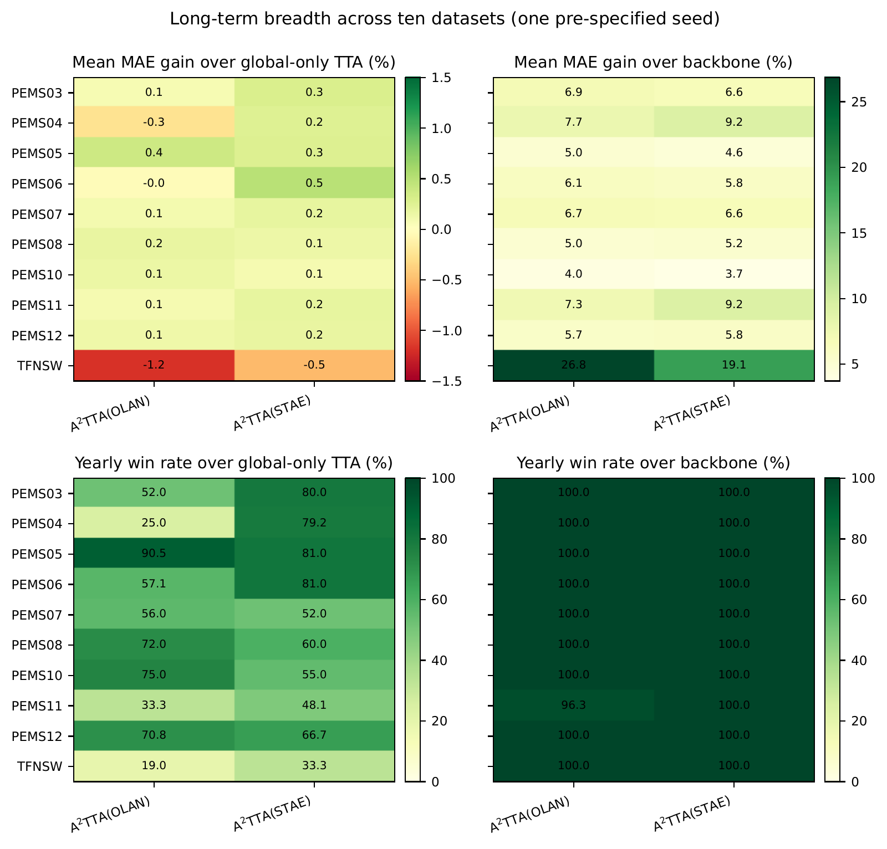

[Vector PDF](assets/long_term_breadth_single_seed.pdf). Long-term single-seed breadth check.

## Protocol Controls and Deployment Cost

### Protocol checks

The result files behind every main-table A²TTA cell record an evaluation
batch size of one, training-only input normalization, metadata-based sensor
identities, a 12-step label delay, and a 64-window global-update interval.
The matched backbone row uses the same per-year checkpoint and seed. For the
new-sensor comparison, all 21 comparable methods were evaluated on the same
metadata-defined transition cohorts over ten networks and five seeds.

### Dependence on yearly warm-up

We also initialize the FiLM calibrator as the identity and skip its three
warm-up epochs on PEMS05, PEMS08, and TFNSW. Across five paired seeds,
removing warm-up increases Avg-MAE by 1.0%, 1.1%, and 2.4% for the
STAEFormer variant and by 1.7%, 1.4%, and 11.4% for the Online-AN variant,
respectively. A²TTA can therefore enter the causal stream without
calibrator warm-up, but the labeled training partition provides a measurable
and sometimes substantial benefit. We retain three warm-up epochs in the main
protocol and do not present it as label-free deployment.

### Controlled cost measurement

We profile the frozen backbone, warm-up-only calibration, global-only TTA, and
full A²TTA on one H200 GPU over 233 natural yearly graph snapshots. Each
snapshot is repeated three times before aggregation. Full A²TTA averages
5.35 ms per window with Online-AN and 11.60 ms with STAEFormer; the frozen
backbones require 4.30 and 10.48 ms, respectively. For STAEFormer, peak
allocated GPU memory rises from 10,021 to 10,552 MiB. The calibrator has an
average of 33.2K updated parameters, including the node table, equal to 1.6%
of the 2.06M-parameter STAEFormer backbone. Yearly online adaptation averages
2.1 s for Online-AN and 2.0 s for STAEFormer after warm-up.

## Hyperparameter Sensitivity

The Online-AN variant uses $3\times10^{-3}$ on PEMS03, PEMS04, PEMS06,
PEMS11, and TFNSW and $10^{-3}$ elsewhere. The STAEFormer variant uses
$3\times10^{-3}$ on TFNSW and $10^{-3}$ elsewhere.

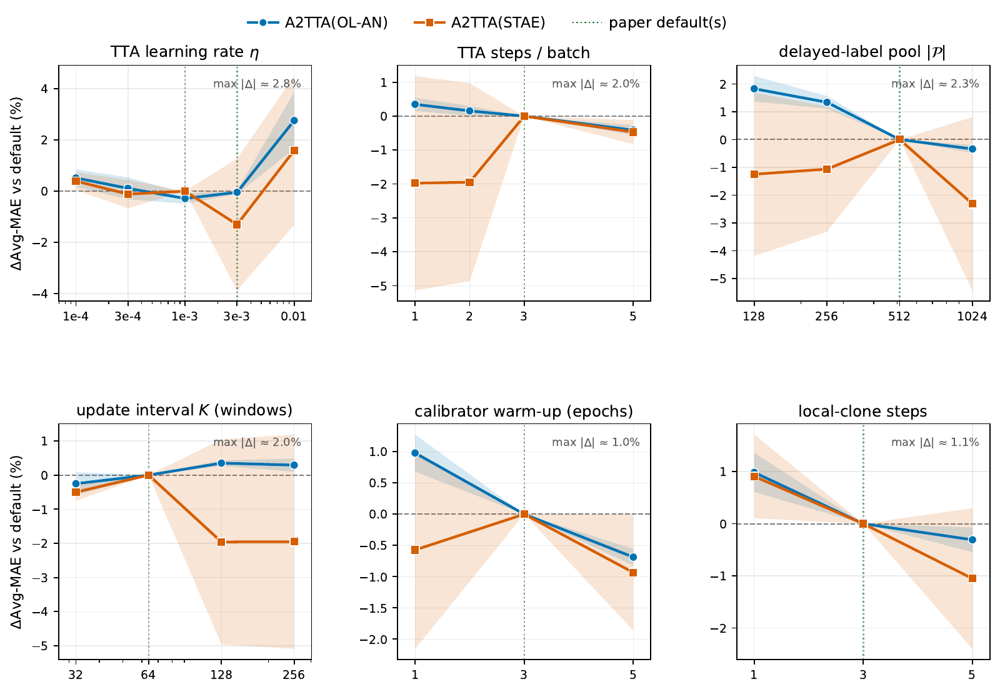

[Vector PDF](assets/hyper_a2tta.pdf). One-at-a-time hyperparameter sensitivity.

Figure [fig:hyper](#fig-hyper) reports a one-at-a-time singleton-window sweep on
PEMS03, PEMS05, and PEMS06 with seeds 51 to 53. The non-learning-rate defaults
are three adaptation steps, a feedback pool of 512 windows, an update interval
of 64 windows, three warm-up epochs, and three local steps. The learning-rate
anchor is $10^{-3}$ for A²TTA(STAE) on all three datasets and for
A²TTA(OLAN) on PEMS05; it is $3\times10^{-3}$ for A²TTA(OLAN) on
PEMS03 and PEMS06. Each dataset-backbone pair is normalized by its own paper
configuration before averaging, so an aggregate learning-rate point that is a
default for only some pairs need not equal zero. Bands show variation across
datasets.

The learning-rate changes in Avg-MAE for A²TTA(OLAN) and
A²TTA(STAE), respectively, are $+0.51\%$ and $+0.39\%$ at $10^{-4}$,
$+0.11\%$ and $-0.12\%$ at $3\times10^{-4}$, $-0.05\%$ and $-1.30\%$ at
$3\times10^{-3}$, and $+2.75\%$ and $+1.59\%$ at $10^{-2}$. With one
adaptation step, the changes are $+0.35\%$ and $-1.98\%$; with a pool of 128
windows, they are $+1.83\%$ and $-1.25\%$. Across the other settings, the
largest absolute mean change is 2.31%. Negative values denote lower Avg-MAE.
The default configuration therefore offers a reasonable accuracy-computation
balance without requiring a separate exhaustive search for each stream.

## Ablation Study Details

The ablation in Figure [fig:ablation](#fig-ablation) starts from the same full stack for
both backbones: a frozen forecaster, node-conditioned FiLM, global updates from
matured labels, and a disposable context-weighted local clone. "w/o local
clone" retains the global update but removes per-window specialization.
"FiLM $\rightarrow$ affine" keeps adaptation and the clone but replaces
input-conditioned modulation with a static scale and shift. "w/o online TTA"
warm-starts FiLM and then freezes it during the test stream, while "backbone
only" removes the calibration stack. All variants process one window at a
time, release labels after 12 windows, and trigger global adaptation every 64
windows. Avg-MAE is the mean of the cumulative scores for horizons 1 to 12.
Values are means and standard deviations over seeds 51–55, with years averaged within each seed.

Reverting to the frozen backbone increases absolute Avg-MAE by
$0.58$–$1.12$ for Online-AN and $0.52$–$1.87$ for STAEFormer, or 6.5% and
6.7% on average relative to the full model. Replacing FiLM with affine costs
$0.41$–$0.72$ and $0.29$–$1.50$, respectively, while removing the local
clone costs $0.07$–$0.25$ and $0.05$–$0.53$. Freezing FiLM after warm-up
raises Avg-MAE by $0.03$–$0.11$ for Online-AN and by $0.09$–$0.13$ for
STAEFormer on PEMS03 to PEMS05. STAEFormer on PEMS06 is the exception: the warm-up-only
variant reaches $11.46\!\pm\!0.22$, compared with $12.18\!\pm\!0.58$ for full
A²TTA, and is better in four of five seeds. The rerun therefore supports
conditional FiLM and local refinement consistently, while online updating is
helpful in most, but not all, settings.

## Case Study Details

The case in Figure [fig:case](#fig-case) uses only cohort membership and traffic variance for selection, not relative forecast errors. We take the first sensor in the new/high-variance cohort by metadata order (sensor ID 601213; graph index 14) and its highest-volatility day, then average predictions from seeds 51 and 52. The rerun evaluates one window at a time and releases labels after 12 steps. Panels (a) and (b) cover all 288 five-minute windows of the selected day. At horizon 1, A²TTA reduces trace MAE from $21.51$ to $20.00$ with Online-AN and from $20.75$ to $18.43$ with STAEFormer. At horizon 12, the corresponding changes are $34.63$ to $25.54$ and $23.85$ to $21.37$.

Panels (c) and (d) report $\mathrm{MAE}_{\mathrm{backbone}}-\mathrm{MAE}_{\mathrm{A^2TTA}}$ for the 366 sensors with valid paired errors, comprising 207 existing and 159 new sensors; positive values indicate improvement. With Online-AN, 206 of 207 existing sensors and all 159 new sensors improve. With STAEFormer, the counts are 204 of 207 and 157 of 159. Mean per-sensor MAE falls by 7.29% relative to Online-AN and 2.62% relative to STAEFormer. The reductions remain similar across existing and new sensors: 7.24% versus 7.36% for Online-AN, and 2.41% versus 2.90% for STAEFormer. This case is illustrative; the multi-dataset, multi-seed experiments provide the aggregate evidence.

## Mechanism Visualization

Figure [fig:mechanism_vis](#fig-mechanism-vis) uses a separate legacy-batched seed-51
PEMS06-2015 A²TTA(STAE) diagnostic. It inspects learned representations
and does not contribute to the accuracy tables. We record internal quantities
only after delayed feedback is available. For every retained window-sensor
pair, we extract the penultimate FiLM features from the persistent global
calibrator and its context-specialized disposable clone.
The two feature sets are concatenated before fitting one shared Uniform
Manifold Approximation and Projection (UMAP). Separate fits would make their
coordinate systems incomparable. For the heatmaps, each cell first averages
over sensors and then over chronological windows whose forecast target begins
in that clock hour.

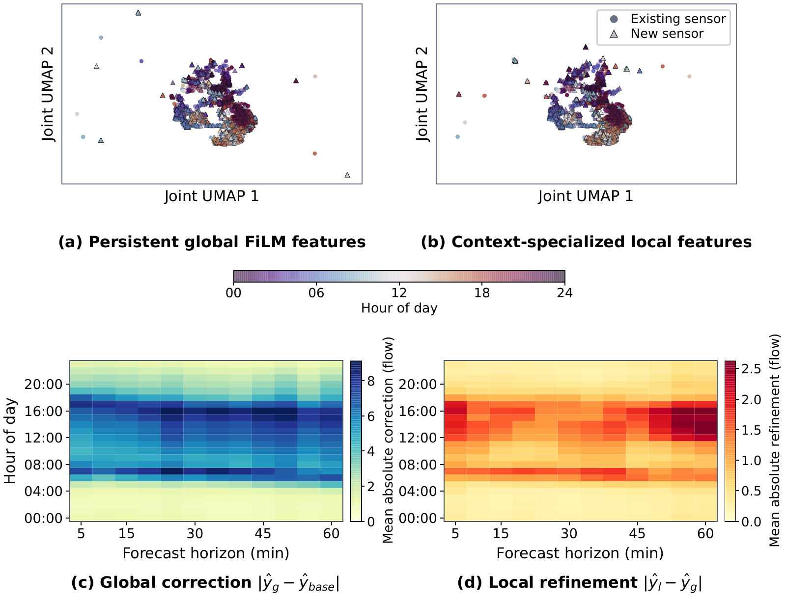

[Vector PDF](assets/mechanism_2x2.pdf). Global and local calibration mechanisms on PEMS06-2015.

The shared projection retains a clear time-of-day organization in both
representations, while the local clone makes comparatively small paired
movements within this structure. The correction maps give the same two-stage
picture in output space: averaged over the captured stream, the global
calibrator changes the frozen forecast by $4.40$ flow units in absolute value,
whereas the local clone adds a $0.90$-unit refinement, or $20.4\%$ of the
global correction magnitude. Both corrections concentrate in the more active
daytime regimes and vary across forecast horizons. Thus, the local clone acts
as a targeted adjustment to a stable global adaptation rather than replacing
it. This single-run visualization is mechanistic and illustrative. The ablations and multi-seed experiments provide the quantitative evidence.

## EvoST Implementation and Feedback Protocol

### Identity parameters and fitting

The identity blocks have shapes $12\times N_y\times80$ for STAEFormer,
$N_y\times32$ for STID, and two $N_y\times10$ tables for Graph WaveNet.
The main STAEFormer maintenance comparison uses the latest 2,048 training
windows, reserving the final quarter for early stopping and selecting the
identity learning rate from $\{10^{-3},3\times10^{-3},10^{-2}\}$.
Arrival experiments use a fixed rate of $3\times10^{-3}$.
These fits use at most 16 epochs and patience 3.

### Arrival history and donors

The arrival experiment provides 64 post-arrival fitting windows before
the stream. Matching uses finite raw readings, including zeros.
A donor must have observations on at least $20\%$ of the available times
and share finite observations with the incoming sensor on at least $20\%$.
If fewer than $k$ donors qualify, all $k$ are sampled without replacement
from the established sensors using a seed fixed for the run.
At zero-based stream index $t_\star=1{,}024$, with $H=12$,
records $0,\ldots,1{,}012$ are eligible. These 1,013 records and the last
11 eligible post-arrival prestream windows supply the $W=1{,}024$
refitting windows. The refit follows that step's RLS update and precedes
its prediction.

### Calibration and evaluation

We use $L=H=12$, giving $D=29$, and update RLS every $\delta=64$ windows.
The history slope is fitted against centered sample indices.
The recursion uses float64 arithmetic and symmetrizes $\mathbf P_n$
after each update.
For each experimental branch, $\rho\in\{1,100\}$ and
$\lambda\in\{1,0.999,0.995,0.99\}$ are selected on the first 1,024
validation windows. With these choices fixed, the calibrators are
initialized again and validation and test windows are replayed
chronologically; reported performance uses the test portion.

We compute the shared scale $s$ as the standard deviation of valid targets
in the initial training tail. The arrival experiments compute this statistic
before applying the node-specific arrival masks.
The arrival restriction applies to donor observations and sensor-specific
fitting records. The shared scale uses the full initial tail and stays fixed.

## Figures and tables cited from the main text

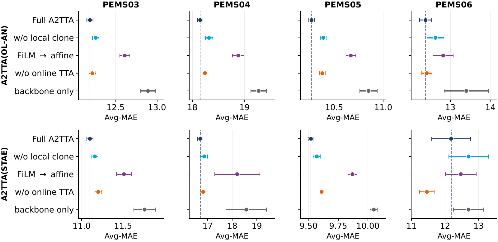

[Vector PDF](assets/ablation_d_absolute_avg_mae_high_contrast.pdf). Component knockouts on four PEMS datasets and two frozen backbones.

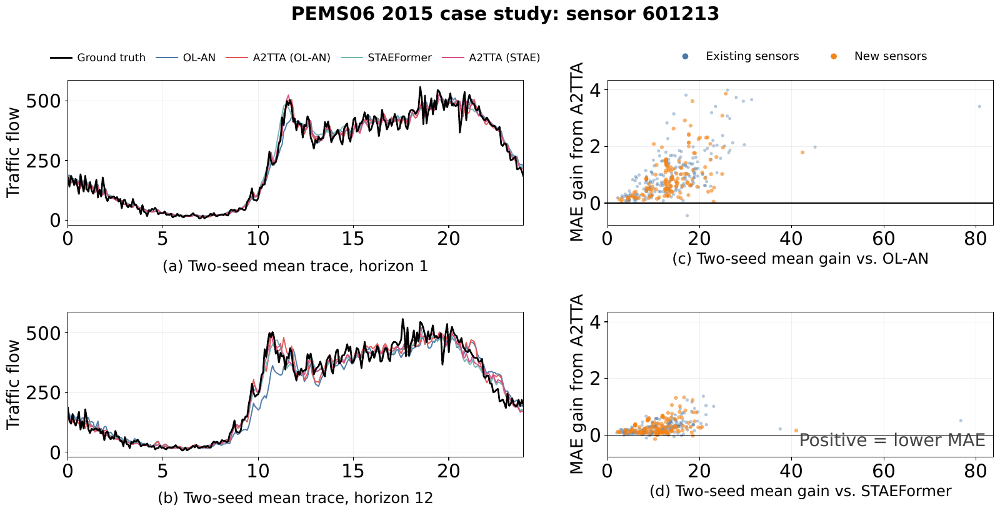

[Vector PDF](assets/case_a2_c_horizontal_PEMS06_2015.pdf). Two-seed case study on PEMS06-2015.

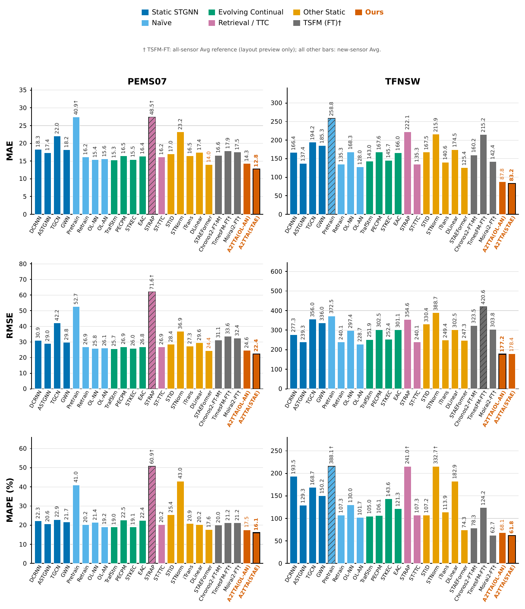

[Vector PDF](assets/new_sensor_baselines3.pdf). New-sensor performance.

[Complete baseline results](../tables/main_table.md) and [paper table sources](paper_sources/table).

[Complete baseline results](../tables/main_table.md) and [paper table sources](paper_sources/table).

[Complete baseline results](../tables/main_table.md) and [paper table sources](paper_sources/table).

[Complete baseline results](../tables/main_table.md) and [paper table sources](paper_sources/table).

[Complete baseline results](../tables/main_table.md) and [paper table sources](paper_sources/table).
